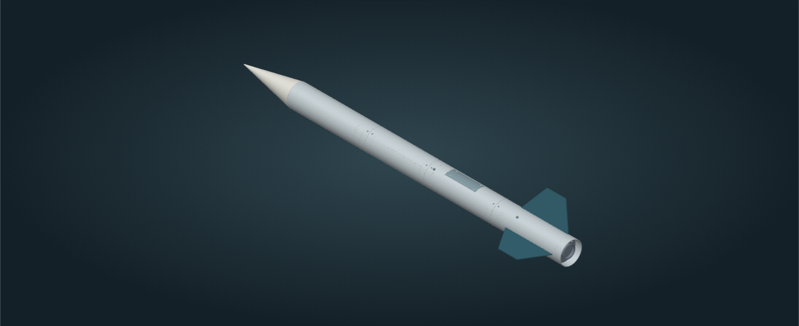

# PLBP · интерактивные модели ГИРД

**[Открыть сайт проекта](https://ogonec17.github.io/Rocket/)**

- **[Н1 · Младший ГИРД](https://ogonec17.github.io/Rocket/model/n1-r01/)** — вращение, разрез, взрыв-схема, МГМ, электроника и парашюты.
- **[Н2 · Старший ГИРД](https://ogonec17.github.io/Rocket/model/n2-r01/)** — самостоятельная компоновка, три поперечных сечения, внутренние узлы, раскрытие и схематическая посадка.
- **SG1 D01** — [архивный внешний вид](assets/d01-isometric.png).

Сайты можно открыть и без интернета: скачайте репозиторий и откройте `index.html`. Работают мышь, сенсорное управление и клавиатура.

Публикуются визуализации, включая разрезы и внутренние узлы. Исходные CAD-сборки, STEP, рабочие скрипты и инженерные архивы хранятся отдельно.

Это цифровые проектные модели. Лётные характеристики, прочность и работа аппаратуры физическими испытаниями пока не подтверждены. Демонстрационные состояния спасения не моделируют динамику.
