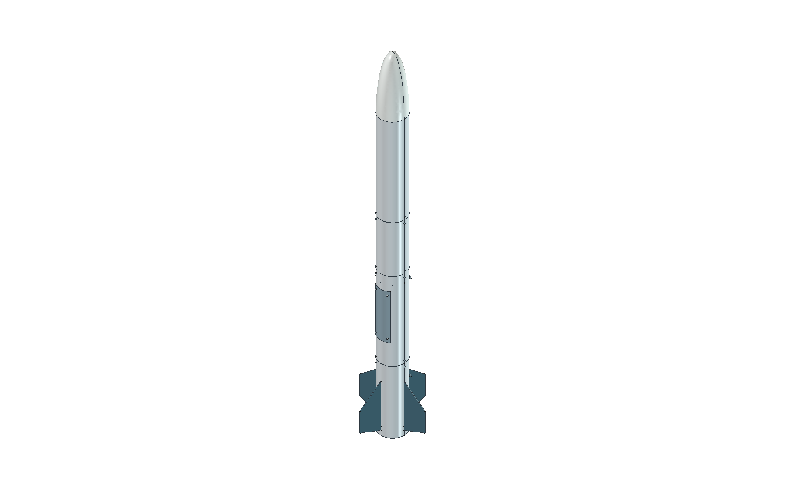

# PLBP · внешняя галерея

Открытая витрина цифровых моделей проекта ГИРД.

- **Н1 R01 · Младший ГИРД** — [изометрия](assets/n1-isometric.png), [спереди](assets/n1-front.png), [сбоку](assets/n1-side.png), [сверху](assets/n1-top.png).
- **SG1 D01 · архивная концепция** — [внешний вид](assets/d01-isometric.png).
- **Сайт-галерея** — скачайте репозиторий и откройте [index.html](index.html). Работает без установки и подключения к интернету. На GitHub HTML отображается как исходный код.

В этом репозитории публикуются только внешние изображения и материалы витрины. Инженерные сборки и внутренние материалы хранятся отдельно.

Изображения цифровых моделей не являются подтверждением лётных испытаний.
