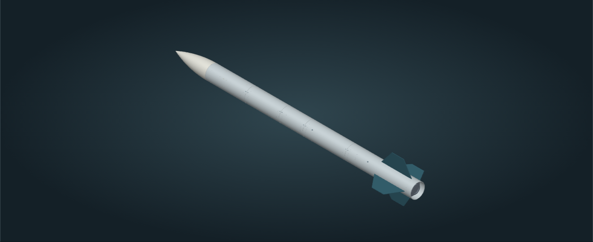

# PLBP · интерактивные модели ГИРД

**[Открыть сайт проекта](https://ogonec17.github.io/Rocket/)**

- **[Н1 · Младший ГИРД](https://ogonec17.github.io/Rocket/model/n1-r02/)** — вращение, разрез, взрыв-схема, МГМ, электроника и парашюты.
- **[Н2 · Старший ГИРД](https://ogonec17.github.io/Rocket/model/n2-r02/)** — самостоятельная компоновка, три поперечных сечения, внутренние узлы, раскрытие и схематическая посадка.
- **[Н3 · Супер ГИРД](https://ogonec17.github.io/Rocket/model/n3-r01/)** — независимая архитектура, 23 режима, разрезы, отдельные секции, МГМ, электроника, спасение и наземная станция.
- **SG1 D01** — [архивный внешний вид](assets/d01-isometric.png).

Сайты можно открыть и без интернета: скачайте репозиторий и откройте `index.html`. Работают мышь, сенсорное управление и клавиатура.

Публикуются визуализации, включая разрезы и внутренние узлы. Исходные CAD-сборки, STEP, рабочие скрипты и инженерные архивы хранятся отдельно.

Это цифровые проектные модели. Лётные характеристики, прочность и работа аппаратуры физическими испытаниями пока не подтверждены. Демонстрационные состояния спасения не моделируют динамику.

## R02

Облегчённые цифровые конструкции Н1 и Н2, подробные узлы, десять режимов просмотра и сравнение OpenRocket. Материалы и двигатели пока условные; прочность и полёт не подтверждены физическими испытаниями. Предыдущие R01 доступны со страниц новых моделей.

## Три самостоятельные сборки

Н1 R02, Н2 R02 и Н3 R01 оформлены в общей системе. VERIFIED обозначает подтверждённое регламентом требование; ASSUMED — допущение; TBD — требует уточнения; NOT_APPLICABLE — не применяется. 1000 м для Н3 является требованием, а не результатом расчёта или испытания. Инженерные комплекты остаются локально.
